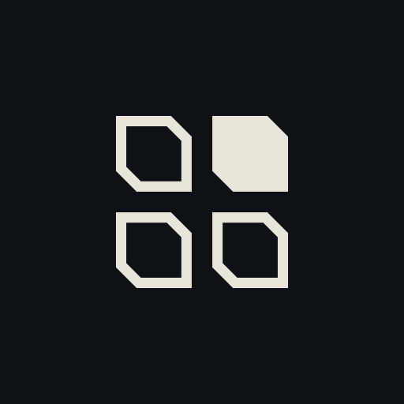
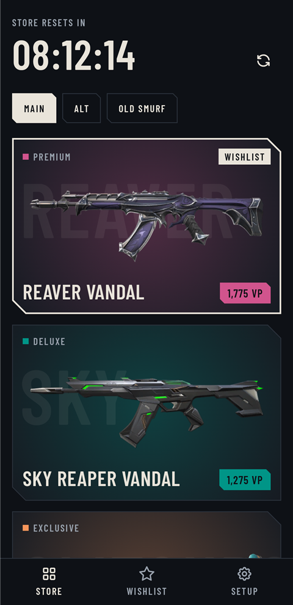
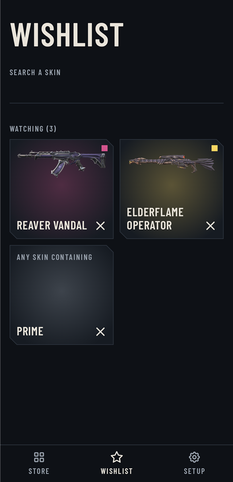

<p align="center"></p>

<h1 align="center">Valo Store Alert</h1>

<p align="center">
  <a href="https://github.com/Arylite/valorant-store-alert/actions/workflows/ci.yml"></a>
  <a href="https://github.com/Arylite/valorant-store-alert/releases/latest"></a>
  <a href="LICENSE"></a>
</p>

Watches the Valorant daily store of several Riot accounts and sends a notification to your phone as
soon as a skin from your wishlist shows up.

<p align="center">
  
  &nbsp;
  
</p>
<p align="center"><sub>Screenshots use fake accounts. Skin names, art and tiers come from valorant-api.com.</sub></p>

## How it works

- **Backend** (`backend/`, TypeScript, Hono): logs in with each account's stored session, reads the
  daily store every 15 minutes and records an alert for every wishlisted skin. It downloads the skin
  catalog (names, art, tiers) from [valorant-api.com](https://valorant-api.com) when the image is
  built and refreshes it daily.
- **Android app** (`android/`, Kotlin + Compose): shows the stores with skin art and VP prices, manages
  the wishlist and the accounts, and polls the backend every 15 minutes in the background to post
  notifications. Accounts are added by signing in on Riot's own login page inside the app.
- **Cloudflare tunnel** (`docker-compose.yml`): the phone reaches the backend over HTTPS, no port is
  opened on your network.

## Deploy the backend

1. Cloudflare Zero Trust > Networks > Tunnels: create a tunnel, copy its token, and add a public
   hostname pointing to `http://backend:8080`.
2. `cp .env.example .env` and fill `API_TOKEN`, `SECRET` (`openssl rand -hex 32` for each) and `TUNNEL_TOKEN`.
3. `docker compose up -d --build` (or `docker compose pull` to use the published image).

The API is on the internet behind the token only: keep `API_TOKEN` long and random. Session cookies
are stored encrypted with `SECRET` in the `data` volume; losing `SECRET` means signing the accounts
in again.

## Install the app

Download `ValoStoreAlert-android.apk` from the [latest release](https://github.com/Arylite/valorant-store-alert/releases/latest),
open **Setup**, enter the tunnel URL and your `API_TOKEN`, then **Add account with Riot**.

The app never sees your password: Riot's login page runs in a web view, and once Riot confirms the
sign-in the app only reads the session cookies and wipes the web view. The backend logs in once to
check the session, detects the region and takes the account name from the Riot ID. Tick "Stay signed
in" on the Riot page. Google and Apple logins do not work inside apps: use your Riot ID.

## Develop

```
cd backend && npm ci && npm test       # typecheck: npm run typecheck, run: npm run dev
cd android && ./gradlew ktlintCheck lintRelease assembleRelease   # needs ANDROID_HOME
```

Debug builds may talk to `http://localhost` (for `adb reverse`); release builds are HTTPS only.

## Releasing

Push a tag `vX.Y.Z`. `release.yml` reuses `ci.yml`, then publishes the signed APK to a GitHub release
and the backend image to `ghcr.io/arylite/valorant-store-alert`. Signing uses the repository secrets
`ANDROID_KEYSTORE_BASE64`, `ANDROID_KEYSTORE_PASSWORD`, `ANDROID_KEY_ALIAS` and `ANDROID_KEY_PASSWORD`;
keep the keystore safe, users must uninstall the app to update if it changes.

## Limits

- Only the 4 daily skins are watched, not the night market, bundles or accessories.
- Matching is a case-insensitive substring of the skin name, so "Reaver" watches the whole line.
- Notifications are polled every 15 minutes (the WorkManager minimum), not pushed.
- This uses Riot's unofficial client API. Riot does not endorse it; use it on your own accounts at
  your own risk. The region detection relies on an undocumented endpoint with a fallback.

See [DESIGN.md](DESIGN.md) for the design brief and [SECURITY.md](SECURITY.md) to report a vulnerability.

## Disclaimer

Valo Store Alert isn't endorsed by Riot Games and doesn't reflect the views or opinions of Riot Games
or anyone officially involved in producing or managing Riot Games properties. Riot Games, and all
associated properties are trademarks or registered trademarks of Riot Games, Inc.
